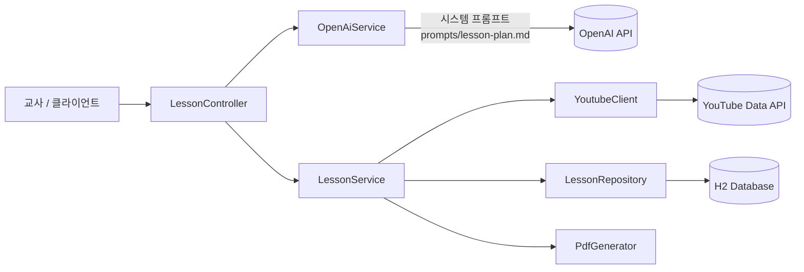

# Route Draft

> 수업 조건을 입력하면 AI가 수업 지도안을 설계해 주는 서비스

교사로 일하며 ChatGPT로 수업을 준비할 때 매번 긴 프롬프트를 쓰고 결과를 다시 다듬는 과정이 번거로웠습니다.
Route Draft는 학교급, 과목, 성취기준 같은 조건을 입력받아 **정해진 형식의 수업 지도안**을 만들고,
수업에 바로 쓸 수 있는 **동기유발 영상**과 **PDF 지도안**을 제공하는 것을 목표로 합니다.

> 🚧 현재 개발 중입니다. 진행 상황은 [마일스톤](https://github.com/s0mmcc0/route-draft/milestones)에서 확인할 수 있습니다.

<br>

## ✨ 주요 기능

| 기능 | 설명 | 상태 |
| --- | --- | --- |
| AI 수업 지도안 생성 | 입력 조건을 바탕으로 학습 목표, 도입·전개·정리 흐름, 활동지, 심화·보충 학습을 생성 | ✅ |
| 동기유발 영상 추천 | AI가 추천한 키워드와 교육 채널로 YouTube에서 실제 영상을 검색해 매핑 | ✅ |
| 지도안 목록·상세 조회 | 생성된 지도안을 저장하고 조회 | ✅ |
| PDF 지도안 다운로드 | 교수·학습 과정안 형식의 PDF 생성 (한글 폰트 내장) | ✅ |
| 회원가입·로그인, 내 보관함 | 교사별 지도안 관리 | 🔜 M3 |
| 부분 편집, 커뮤니티 공유, 피드백 댓글 | 도입·전개·정리 단계별 수정, 지도안 공유와 현장 적용 후기 | 🔜 M4 |

<br>

## 🛠️ 기술 스택

| 구분 | 기술 |
| --- | --- |
| Language | Java 21 |
| Framework | Spring Boot 4.0.6, Spring Data JPA |
| Database | H2 (개발용) → MySQL 전환 예정 |
| AI | OpenAI API (gpt-4o-mini), RestTemplate 직접 연동 |
| External API | YouTube Data API v3 (WebClient) |
| PDF | OpenPDF 2.0.3, 나눔고딕 폰트 |
| Build | Gradle |

<br>

## 🏗️ 아키텍처



### 지도안 생성 흐름

1. 교사가 수업 조건(학교급, 학년, 과목, 성취기준, 수업 스타일, 수업 시간, 학생 수, 기자재 환경)을 입력
2. 'OpenAiService'가 외부 파일로 분리된 시스템 프롬프트와 입력 조건을 조합해 OpenAI에 JSON 형식 응답을 요청
3. 'LessonService'가 AI가 추천한 키워드와 교육 채널로 YouTube 영상을 검색해 응답에 매핑
4. 결과를 DB에 저장하고, 실제 영상 정보가 반영된 지도안을 반환

<br>

## 📡 API

| Method | Endpoint | 설명 |
| --- | --- | --- |
| POST | '/api/v1/ai/lessonㅍ | 수업 지도안 생성 |
| GET | '/api/v1/ai/lessons' | 지도안 전체 목록 조회 |
| GET | '/api/v1/ai/lessons/{id}' | 지도안 상세 조회 |
| GET | '/api/v1/ai/lessons/{id}/pdf' | 지도안 PDF 다운로드 |

<details>
<summary>지도안 생성 요청 예시</summary>

```json
POST /api/v1/ai/lesson
{
  "schoolLevel": "중학교",
  "grade": "2학년",
  "subject": "정보 - 제어 구조",
  "achievementStandard": "[9정04-03] 순차, 선택, 반복 구조를 이해하고 프로그램을 작성한다.",
  "lessonStyle": "활동 중심",
  "duration": "45",
  "studentCount": 24,
  "environment": "1인 1PC 컴퓨터실"
}
```

</details>

<details>
<summary>응답 구조</summary>

| 필드 | 내용 |
| --- | --- |
| 'lesson_title' | 수업 제목 |
| 'learning_objectives' | 학습 목표 목록 |
| 'environment_setup' | 모둠 구성 제안, 준비물 |
| 'lesson_flow' | 도입·전개·정리 단계별 교사·학생 활동과 시간 |
| 'student_activity_sheet' | 학생용 활동지·퀴즈 |
| 'motivation_assets' | 추천 키워드, 교육·뉴스 채널 영상, 실생활 사례 |
| 'advanced_learning' | 심화 학습 |
| 'remedial_assignment' | 보충 과제와 교사용 지도 가이드 |

</details>

<br>

## 🚀 실행 방법

### 1. 사전 준비

- Java 21
- OpenAI API Key
- YouTube Data API v3 Key

### 2. 환경 변수 설정

```bash
export SPRING_AI_OPENAI_API_KEY=your-openai-api-key
export YOUTUBE_API_KEY=your-youtube-api-key
```

### 3. 실행

```bash
./gradlew bootRun
```

서버는 'http://localhost:8080'에서 실행됩니다.

<br>

## 🧭 로드맵

기능 개발과 함께 보안 설계를 단계적으로 적용하고 있습니다.

| 마일스톤 | 내용 | 상태 |
| --- | --- | --- |
| M0 MVP 구축 | 지도안 생성, 조회, YouTube 매핑, PDF 다운로드 | ✅ 완료 |
| M1 기반 정비 | 문서·작업 규칙 정비, 리팩토링, 테스트, 예외 처리, 입력값 검증 | 🔄 진행 중 |
| M2 보안 진단 | 위협 모델 작성, MySQL 전환, 설정 보안 강화, 의존성 취약점 점검 자동화 | ⏳ |
| M3 회원과 인증 | 회원가입·로그인, 내 보관함, 접근 제어 | ⏳ |
| M4 편집·공유·커뮤니티 | 부분 편집, 공유, 피드백 댓글, XSS·권한 검증 | ⏳ |
| M5 LLM 보안 | 프롬프트 인젝션 대응, AI 출력 검증, 요청량 제한, 공격 테스트 | ⏳ |
| M6 배포와 정리 | Docker 배포, 보안 헤더·시크릿 관리, 보안 리포트 | ⏳ |

<br>

## 🔥 트러블슈팅

개발 중 겪은 주요 문제와 해결 과정은 [TROUBLESHOOTING.md](./TROUBLESHOOTING.md)에 기록하고 있습니다.

| 문제 | 해결 |
| --- | --- |
| Spring AI 라이브러리가 지원하지 않는 파라미터를 보내 OpenAI 400 에러 발생 | 의존성을 제거하고 RestTemplate으로 필수 규격만 직접 조립 |
| 로컬 파일 로드 단계의 예외가 401로 응답되어 API 키 문제로 오인 | 요청 경로와 키 참조 방식을 바로잡고 실제 실패 지점을 추적 |
| 인메모리 H2를 외부 DB 툴에서 조회할 수 없음 | H2 TCP 서버를 내장 구동하고 의존성 범위 수정 |
| AI가 존재하지 않는 채널명을 만들어 무관한 영상이 매핑됨 | 프롬프트에 채널·키워드 생성 규칙을 추가해 검색 품질 개선 |

<br>

## 📋 작업 규칙

이 프로젝트는 이슈 → 브랜치 → 커밋 → PR 흐름으로 진행합니다. 라벨, 브랜치, 커밋 규칙은 [CONTRIBUTING.md](./CONTRIBUTING.md)를 참고해 주세요.
